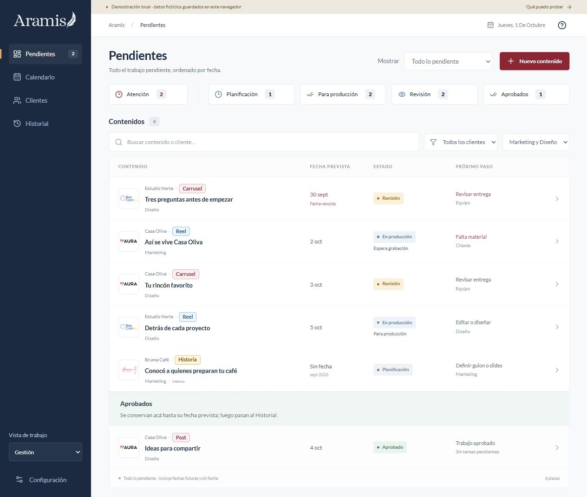
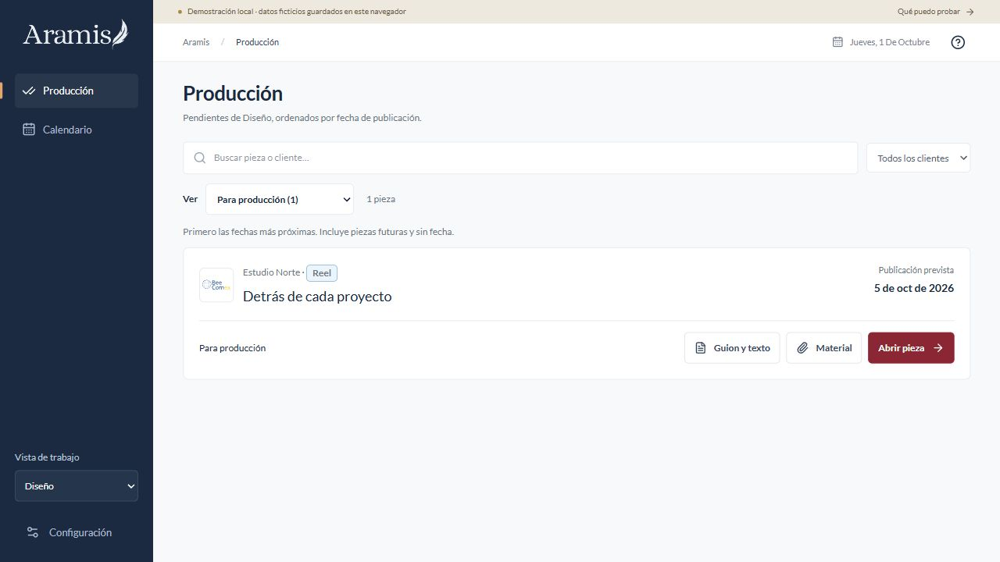
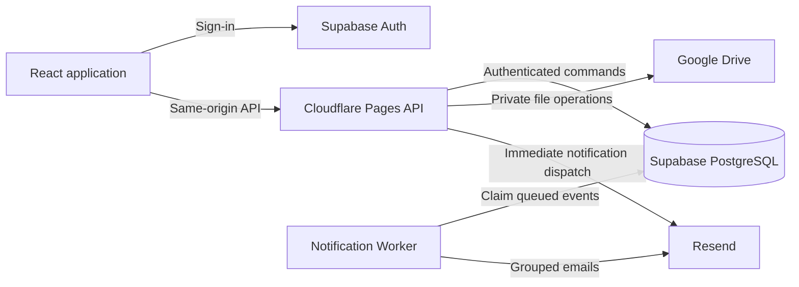

# Gestor Aramis

**Content operations for a working marketing agency.**

Gestor Aramis brings monthly planning, production assets, design handoffs and review into one workspace. It was built around the day-to-day work of the Aramis team and is now used internally to coordinate real content production.

**Current status:** the internal V1 is complete, deployed and in use by the team. Planning, production and review were already part of the working release before email notifications were added as a subsequent improvement. Client-facing calendars, approvals and material requests exist as local prototypes; their live integration is the next product phase.

[Open the deployed app — team login required](https://gestor.aramis.agency/) · [Run the local demo](#run-the-local-demo) · [Architecture](#architecture) · [Verification](#verification)

[About Gestor Aramis](https://gestor.aramis.agency/acerca/) · [Privacy policy](https://gestor.aramis.agency/privacidad/) — public English pages, accessible without a team account.



*Screenshots use fictional demo data. The application UI is in Spanish.*

## The operational problem

The team plans posts and reels, writes scripts, records footage, produces finished pieces and reviews them before publication. Communication and files already live in WhatsApp and Google Drive. The recurring problem is the handoff: design needs to know which pieces are ready, where their material is and what changed when a piece comes back for corrections.

The product follows that workflow. Marketing manages the plan; design opens a production queue with direct access to scripts and material. Drive remains the file store. Email summaries make new handoffs visible even when nobody has the app open.

The planned client experience follows the same principle: a WhatsApp message opens the relevant calendar, approval or upload page directly. Those remote client flows are not active in the deployed V1 yet.

## Current functionality

| Capability | Behavior |
|---|---|
| Monthly planning | Configure each client's post and reel quantities, then explicitly generate the month's missing pieces. Existing work is preserved; dates are assigned manually. |
| Pending work | Show all pending content by date, including overdue, future and undated pieces. Filter by client, area or stage; optionally narrow to this week. |
| Design workspace | Open directly to pieces ready for production, with deadlines, correction reasons and shortcuts to scripts, material and the piece detail. Other stages remain available for reference. |
| Calendar | Browse planned content without expanding a day indefinitely when it contains many pieces. The plan month and publication date are separate. |
| Scripts and copy | Edit within the piece and open saved text in a separate reading tab. Stories use one content field for their slides. |
| Source material | Upload to Drive through the app, or add files directly to the linked Drive folder and bring them into the piece when the app checks it. Preview thumbnails, download originals or download a ZIP. |
| Delivery and review | Keep finished work separate from source footage. Submit an ordered, versioned delivery for review; approve it or return it to production with a required reason. |
| History | Keep approved work visible through its planned publication date, then show it in History. Archive and restore pieces while preserving their records and files. |
| Email notifications — added after V1 | Notify design about production entries and returns, and marketing about new deliveries for review. Daily summaries default to 09:00 Argentina; each person can change frequency, time or pause them. |

### Workflow

```text
Planning → Production → Review → Approved
               ↑           │
               └───────────┘
                Changes requested, with a reason
```

Uploading source files does not approve a piece or establish that its footage is complete. Submitting a delivery is an explicit action. Approval applies to a specific delivery version, including its text and file order.

<details>
<summary>View the design production queue</summary>



</details>

## Product and engineering decisions

- **Keep design in the workspace.** Scripts, source material, deadlines and correction reasons are accessible from the task. For large mobile batches, marketing can use the native Drive app's upload flow and design can retrieve the files through the workspace.
- **Treat work views as preferences.** Management and Design change the starting screen, not authorization. Notification areas are stored separately from browser preferences and task ownership.
- **Preserve the version being reviewed.** Finished deliveries reference pinned Drive revisions. A later edit to the source file must not silently change the content associated with an approval.
- **Make retries safe.** Commands use request identifiers and expected revisions. A lost response can be retried without creating duplicate work or overwriting another person's changes.
- **Notify about actionable changes.** Events are recorded in the same transaction as workflow changes. Summaries exclude work that no longer needs the recipient's intervention and do not repeatedly email the same overdue task.
- **Keep demo and production explicit.** The local demo stores fictional data in the browser. Missing production configuration produces an error rather than falling back to demo data.

## Architecture

| Layer | Implementation |
|---|---|
| Interface | React, TypeScript and Vite; Radix UI primitives, Tailwind CSS and custom styles |
| Web and API | Cloudflare Pages with a same-origin `/api` handler shared with the development Worker |
| Identity and data | Supabase Auth and PostgreSQL; membership checks, RLS and transactional RPCs |
| Files | Google Drive API; encrypted OAuth credentials, resumable uploads, private streaming and pinned delivery revisions |
| Notifications | A dedicated Cloudflare Worker with Cron triggers, a PostgreSQL outbox and Resend |
| Verification | Vitest, PGlite and Playwright; separate checks against hosted services |



Administrative Supabase and Resend keys stay on the server; Google integration tokens are stored encrypted. Core workspace commands run with the signed-in user's identity; specialized file and notification operations use private server credentials with their own authorization checks. Internal drafts and notes are kept separate from client-visible content.

Cron runs independently of page visits. Database leases coordinate scheduled and immediate dispatch; retries keep the same email body and Resend idempotency key. Uncertain sends beyond the retry window are held for review instead of resent blindly.

Workspace changes refresh when the tab regains focus and every 15 seconds while visible. Drive imports are checked from the app; there is no continuous background watcher of every Drive folder.

### Repository layout

```text
contracts/             Shared domain and notification types
src/domain/            Business rules, selectors and fictional demo fixtures
src/internal/          Planning, production, delivery, history and settings UI
src/client/            Client-facing local prototypes
src/lib/               Data adapters, uploads and notification preferences
server/                Authorization, workspace API, Drive and email services
functions/             Cloudflare Pages API entry point
supabase/migrations/   PostgreSQL schema and transactional operations
supabase/tests/        Targeted SQL verification scripts
tests/                 Unit, SQL and browser tests
scripts/               Build, deployment preparation and smoke checks
docs/                  Setup notes, implementation plans and demo screenshots
handoffs/              Dated implementation evidence and continuation notes
```

## Run the local demo

Tested on Windows with **Node.js 24 and npm 11**. No external accounts are required for the demo.

```bash
npm ci
npm run dev
```

Open [http://127.0.0.1:5173](http://127.0.0.1:5173/). The port must be available; stop the server with Ctrl+C. If PowerShell blocks `npm.ps1`, use `npm.cmd` for the same commands.

The default mode is `demo`. Changes survive reloads in that browser; locally attached files are stored in IndexedDB. Nothing is uploaded to Drive, no real emails are sent and demo links do not share data between devices. The JSON export contains workspace metadata, not attached file contents.

### Suggested walkthrough

1. Open **Clientes**, select a client and work on its month. Edit the plan and generate its missing content.
2. Open a piece, set its format and date, and save its script or slide text.
3. Switch **Vista de trabajo** to **Diseño** to see the production queue and open the saved script or material.
4. Return to **Gestión** and explore pending work, the calendar and history.
5. Explore the client prototypes: [calendar](http://127.0.0.1:5173/calendar/demo-calendar), [approval](http://127.0.0.1:5173/request/demo-review) and [material request](http://127.0.0.1:5173/request/demo-material).

Sample links can become invalid after their revision is changed or revoked. Resetting the demo from Settings restores the fixtures and removes local workspace changes.

## Connected development and deployment

Connected mode requires an independently configured Supabase project, staff accounts and workspace membership. The full internal deployment also needs Cloudflare, a Google OAuth connection and a verified Resend sender.

For the frontend, create an ignored `.env.shared.local` file:

```dotenv
VITE_APP_MODE=production
VITE_SUPABASE_URL=https://YOUR_PROJECT_REF.supabase.co
VITE_SUPABASE_PUBLISHABLE_KEY=YOUR_PUBLIC_PUBLISHABLE_KEY
VITE_API_BASE_URL=/api
```

Copy `.dev.vars.example` to `.dev.vars` and configure the matching public database settings and `ARAMIS_WORKSPACE_ID`. Drive and notifications require additional private server configuration described in the integration handoffs. Never place secrets in `VITE_*` variables.

Run the API and frontend in separate terminals:

```bash
npm run worker:dev
npm run dev:shared
```

Open [http://127.0.0.1:5174](http://127.0.0.1:5174/). This mode uses real configured services; it does not import local demo data.

For a new database, review migration dependencies before applying them in order. Do not replay already applied migrations or run all SQL test/operator files against production: some are isolated test fixtures and others require an explicitly controlled test workflow.

Production builds use `pages:prepare` to create a separate package under the ignored `work/pages-deploy` directory. This keeps the local demo build out of deployment and checks the package for configured private keys. Publication uses `pages:deploy`; the notification Worker has its own `notifications:deploy` command. Deployment scripts target the existing Aramis projects and must be reviewed before use with another account. A Git commit or push alone does not deploy the app.

## Verification

```bash
npm test
npm run typecheck
npm run build
npx playwright install chromium
npm run test:e2e
npm run test:e2e:shared
npm run worker:check
npm run notifications:check
```

- **Unit and SQL tests:** domain transitions, data integrity, PostgreSQL permissions, revision conflicts, idempotency, upload recovery, delivery versions and notification scheduling.
- **Browser tests:** demo workflows and shared UI behavior with mocked services, including mobile layouts, lost save responses, concurrency and login-gated email links.
- **Deployment checks:** compilation and anonymous smoke checks for login, API configuration, session requirements and cross-origin rejection.
- **Hosted verification:** recorded separately for real Supabase transactions, Drive file operations and email delivery. A mocked transport test is not evidence of a successful external integration.

The **October 1, 2026 checkpoint** records 525 passing unit tests across 23 files and 27 shared browser flows. It also records a real grouped email accepted and marked delivered by Resend, authenticated preference saving and a smoke check of the published app. Detailed evidence is in [PROJECT_STATE.md](PROJECT_STATE.md) and the [email handoff](handoffs/C11-email-notifications.md). These checks do not imply that every workflow has been tested with every team member or device.

## Development approach

The project was developed with AI coding agents through scoped implementation blocks, shared contracts, automated checks and written handoffs. Product decisions came from the agency's actual workflow and feedback from marketing and design. Iteration included mobile upload behavior, Drive permissions, production queue visibility, review corrections and notification frequency.

The work spans operational discovery, workflow design, service integration and deployment verification. The repository documents decisions and evidence so work can continue across sessions without relying on conversation history.

## Current boundaries and next steps

The internal V1 covers the team's planning, production and review workflow and is already in use. Client access, live calendar links, remote approvals and client uploads belong to the next product phase. Authentication emails and self-service account recovery are separate improvements. Social publishing is handled outside the app. Internal metrics come after the client workflows.

Each deployment needs its own Google OAuth configuration for the Drive integration, separate from staff sign-in through Supabase. Connection setup and renewal procedures are documented in the Drive handoffs; the OAuth publishing status of the current Aramis deployment is an operational detail recorded in [PROJECT_STATE.md](PROJECT_STATE.md).

Browser uploads depend on the browser remaining active; the native Drive app is the practical option for large mobile batches. Google video playback also depends on the viewer's own Drive access, and a pinned delivery is distinct from a source preview. These operating constraints are documented in the Drive handoffs.

## Project documentation

| Document | Purpose |
|---|---|
| [PROJECT_STATE.md](PROJECT_STATE.md) | Current deployment, dated validation evidence and the next checkpoint |
| [ROADMAP.md](ROADMAP.md) | Implementation blocks and acceptance criteria |
| [DECISIONS.md](DECISIONS.md) | Product and architecture decisions |
| [Shared setup](docs/SHARED_SETUP.md) | Staff access and connected local development |
| [Pages deployment](docs/PAGES_DEPLOY.md) | Packaging, publication and smoke checks |
| [Drive import handoff](handoffs/C04-drive-import.md) | Folder provisioning and material added outside the app |
| [Delivery and review handoff](handoffs/C05-delivery-review.md) | Versioned deliveries and correction flow |
| [Email notification handoff](handoffs/C11-email-notifications.md) | Verified sender, scheduling, recovery and operational evidence |

Engineering notes are mostly in Spanish and include historical checkpoints. Use the latest dated entry in `PROJECT_STATE.md` and the relevant handoff when resuming work.
